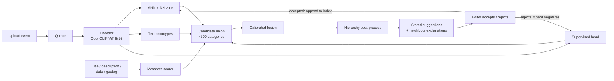

# Automatic Category Suggestion for Wikimedia Commons

Given a newly uploaded image (and, optionally, its title, description, date and geotag), this system returns a **ranked, explained list of Commons categories** for a human editor to accept or reject. It never edits Commons.

It is a hybrid retrieval + classification system built on open components:

| Scorer | What it does | Why |
|---|---|---|
| **k-NN retrieval** | Similarity-weighted label vote over the K nearest categorised images (ANN index) | Works for any category that has examples. New images and categories need **no retraining**. The neighbours are the explanation shown to editors. |
| **Text prototypes (zero-shot)** | Cosine between the image embedding and the embedded category name (prompt ensemble) | Covers rare and brand-new categories with few or no examples. |
| **Supervised head** | Linear multi-label head on frozen embeddings, **asymmetric loss** with a margin, initialised from the text prototypes | Most accurate on frequent categories. Tolerates missing labels. |
| **Metadata scorer** | Text-tower embedding of title + description, lexical match of the category name, year match, distance-weighted vote of nearby geotagged images | Events, places and abstract concepts are often not visible in the pixels alone. |
| **Calibrated fusion** | Logistic regression (or GBDT) over each image's candidate set (union of every scorer's top-N, a few hundred categories, never all of C) | Calibrated scores, and interpretable weights. |
| **Hierarchy post-processing** | Suppresses an ancestor when a more specific descendant is selected. Keeps a strong ancestor when no descendant scores well. | Matches the Commons "most specific category" convention. |



## How each requirement is met

| Requirement | Mechanism | Evidence (generated) |
|---|---|---|
| Objects, scenes, events, abstract concepts | Image, text and metadata scorers fused. Seeds cover all four types plus 15 cities across Africa, Asia and Latin America. | `reports/RESULTS.md` → "by category type" |
| Large, noisy, volunteer labels | Maintenance, tracking, provenance, licence and redirect categories removed. Missing labels are treated as *unknown*: ASL margin, and ancestors are excluded from fusion negatives. | `catsuggest/labels.py`, `scripts/s03_build_dataset.py` |
| Accuracy on **new** images | Temporal split, uploader-disjoint, near-duplicates removed by dHash and by embedding cosine | `reports/data_stats.json`, `reports/metrics.json` |
| Ranking metrics | Sample-wise P@k, R@k, F1@k and mAP. Macro (per-category) metrics. Hierarchy-aware precision. Head, torso, tail and zero-shot bands. | `reports/RESULTS.md` |
| Efficient and scalable | One encoder pass plus one ANN lookup. FAISS Flat, HNSW or IVF-PQ. Latency p50/p95, throughput, index size and memory are measured. | `reports/benchmark.json` |
| Varied quality and resolution | Encoder fixed-size preprocessing. Head trained on blurred, JPEG-compressed, downscaled and cropped views. Metrics under corruptions and by original resolution. | `reports/robustness.json` |
| Learns from new data | When an editor accepts a suggestion, the image joins the k-NN index at once (demo: on submit; API: `POST /feedback/apply`). New categories are usable immediately. Rejects become hard negatives for the next head retrain. Monitoring raises a drift flag that triggers a retrain. | `catsuggest/feedback.py`, `scripts/s14_monitor.py` |
| Open, transparent, inclusive | Open weights (OpenCLIP, LAION-2B) and open code. Neighbours and fusion contributions are shown. Region and label-script audits. No person identification. | `app/demo.py`, `docs/MODEL_CARD.md` |

## Quick start

Requirements: Python 3.9–3.11 (3.11 recommended; 3.13 and newer will **not** work, because there are no PyTorch 2.2 builds for them). A GPU is optional: Apple-silicon `mps` and plain CPU both work. `run_all.py` works the same on macOS, Linux and Windows (`run_all.sh` is the bash equivalent).

```bash
python3 -m venv .venv && source .venv/bin/activate
# Install through your organisation's internal package registry:
pip install --index-url "$INTERNAL_REGISTRY_URL" -r requirements.txt
pip freeze > requirements.lock            # commit the lockfile

export COMMONS_CONTACT="you@example.org"  # required by the Wikimedia User-Agent policy
python3 -m unittest discover -s tests     # all tests should pass

python run_all.py --quick   # smoke test: 10 seeds x 150 files, ~15-30 min
python run_all.py           # full run: ~25k images, ~1-2 h (mostly polite crawling)
```

Then:

```bash
python3 app/demo.py                               # web UI on http://127.0.0.1:7860
uvicorn app.api:app --host 127.0.0.1 --port 8000  # REST API (docs at /docs)
curl -F image=@photo.jpg -F title="Diwali lamps in Jaipur" http://127.0.0.1:8000/suggest
python3 scripts/stream_worker.py --max-events 20  # live suggestions for real new uploads (read-only)
```

The first run downloads the OpenCLIP weights from the Hugging Face Hub, so it needs network access.

## Pipeline

| Step | Script | Output |
|---|---|---|
| 1 | `s01_fetch_commons.py`: BFS below seed categories; file info, categories, parents, redirects | `data/raw/` |
| 2 | `s02_download_images.py`: 330 px thumbnails, re-encoded as RGB JPEG | `data/images/` |
| 3 | `s03_build_dataset.py`: label cleaning, licence filter, split, dHash dedup, vocabulary | `data/processed/`, `reports/data_stats.json` |
| 4 | `s04_embed.py`: image, metadata and category-name embeddings; degraded views; embedding dedup | `artifacts/embeddings/` |
| 5 | `s05_train_head.py`: ASL head, text-initialised, early stopping on val mAP | `artifacts/head.npz` |
| 6 | `s06_build_index.py`: category store; k-NN memories (train-only for eval, all for serving) | `artifacts/` |
| 7 | `s07_fit_fusion.py`: stacking on the validation split (logreg and GBDT) | `artifacts/fusion/`, `reports/fusion.json` |
| 8 | `s08_evaluate.py`: test metrics, ablations, stratified audits, review sample | `reports/metrics.json` |
| 9 | `s09_robustness.py`: blur, JPEG, low-resolution and crop corruptions | `reports/robustness.json` |
| 10 | `s10_benchmark.py`: latency, throughput, memory, index size | `reports/benchmark.json` |
| 11 | `s11_report.py`: builds `reports/RESULTS.md` from the JSON files | `reports/RESULTS.md` |
| 12 | `s12_apply_review.py` (optional, human): strict vs reviewed precision | `reports/review.json` |
| — | `s13_apply_feedback.py` (offline, while no server is running) and `s14_monitor.py`: continual learning and drift monitoring | serving index, `reports/monitoring.json` |

All settings are in `config.yaml`: seeds, split mode, encoder, K, τ, ANN type, loss parameters, fusion model, and so on.

## Evaluation protocol

* **Test = the future.** The split is ordered by upload time and grouped by uploader, so every uploader is in exactly one split. Val and test images that are near-duplicates of training images (dHash ≤ 4 bits, or embedding cosine ≥ 0.97) are removed. The k-NN index used for evaluation contains **training images only**.
* **Metrics.** Sample-wise P@k, R@k, F1@k and mAP measure the quality an editor sees. Macro metrics per category show tail behaviour. Hierarchy-aware hP@k gives 0.5 credit to a predicted ancestor or descendant of a true label.
* **Ablations.** Each scorer is evaluated alone and compared with fusion (logreg and GBDT), fusion + hierarchy, and image-only (no metadata).
* **Stratification.** Results are broken down by training-frequency band (head ≥ 50, torso 10–49, tail 1–9, zero-shot 0), category type, label script, geotag region and original resolution.
* **Missing labels.** `reports/review_sample.csv` lists sampled "wrong" suggestions. Mark each one y or n, then run `s12_apply_review.py` to report the strict score alongside the reviewed score.
* **Efficiency.** End-to-end p50/p95 latency per image, throughput, index bytes, peak memory, and a projection to 10⁸ images.

**Results:** after running the pipeline, see [`reports/RESULTS.md`](reports/RESULTS.md). Every number in it is produced by the scripts. None are typed by hand.

## Serving and scale

* Uploads run at roughly 10⁴–10⁵ per day, about 1 image/s at peak. One quantised ViT-B forward pass plus a millisecond ANN query per image is enough on a single GPU or a few CPU cores.
* FAISS is used on Linux. On macOS and Windows the exact numpy search is used instead, because the FAISS and PyTorch wheels each bundle an OpenMP runtime and the two can clash.
* Index size for 10⁸ images at 512-d: about 102 GB as flat fp16, about 6.4 GB with product quantisation at 64 B per vector (`knn.index: ivfpq`). HNSW is also available.
* The path is asynchronous: upload event → queue → encoder → ANN → fusion → stored suggestions. Uploads are never blocked. `scripts/stream_worker.py` demonstrates this on the live Wikimedia EventStreams feed.
* Planned next steps for production: INT8 or ONNX export of the encoder, after measuring the accuracy drop on the held-out set.

## Responsible use

* Suggestions only. A human approves every category.
* Categories of individual people are removed from the label space (parents `Men/Women/People by name`). The system does not identify people.
* Only openly licensed files are used. Thumbnails stay local and are not redistributed.
* Region and script audits are part of every evaluation. The seeds deliberately include many non-Western topics and cities.

## Limitations

* Category types (object, scene, event, abstract) are assigned by a keyword heuristic, and regions by rough bounding boxes. Both are approximations used only for reporting.
* The vocabulary is every category carried by a crawled image, plus all crawled parent and grandparent categories as distractors (often tens of thousands). That is still fewer than the millions of categories on Commons, so real-world candidate generation is harder.
* The crawl starts from seed categories, so the category distribution differs from the global upload stream.
* Image timestamps come from the latest file revision, which can differ from the original upload time for re-uploaded files.

## Project layout

```
catsuggest/   library: labels, hierarchy, split, metrics, scoring, encoder, ANN, head, fusion, suggester
scripts/      pipeline steps s01-s14, live stream worker
app/          FastAPI service and Gradio demo
tests/        unit tests (pure-Python logic + numeric tests)
docs/         model card, submission checklist, slide outline
config.yaml   all settings
```

## Licence

Code: MIT (see `LICENSE`). Model weights: OpenCLIP / LAION, under their respective licences. Images and metadata come from Wikimedia Commons under their individual free licences and are not included in this repository.
